<div align="center">


# Switchyard

**自托管的 LLM 编组网关 —— 多条上游汇入，一种协议发出，每一次调用都被计量。**

[](#版本号与发布)
[](go.mod)
[](LICENSE)
[](#快速开始)

[English](README.md) | 简体中文

</div>

> **名字与来历。** Switchyard 源自早期开源 LLM 网关基线的生产分支，后来远超它 —— 选路、计费、媒体处理与
> 运维基本重写过。现在它以**Switchyard** 这个名字独立发布，而这个名字说的正是它做的事：LLM 流量的编组场。
> 本项目仍以 AGPL-3.0 授权（见 [LICENSE](LICENSE)）；与原基线的差异逐条记在 [CHANGELOG.md](CHANGELOG.md) 里。

---

## 目录

**从这里开始**

- [它做什么](#它做什么)
- [编组模型](#编组模型)
- [快速开始](#快速开始)
- [客户端接入示例](#客户端接入示例)

**工作原理**

- [协议兼容性](#协议兼容性)
- [转发：选路、故障转移与错误处理](#转发选路故障转移与错误处理)
- [定价与计费](#定价与计费)
- [渠道、分组与发布](#渠道分组与发布)
- [限额与访问控制](#限额与访问控制)
- [角色与管理界面](#角色与管理界面)
- [站点身份与维护模式](#站点身份与维护模式)

**运维**

- [运维：健康探测、告警、指标、备份](#运维健康探测告警指标备份)
- [配置](#配置)
- [接口总览](#接口总览)

**参考**

- [界面截图](#界面截图)
- [文档](#文档)
- [从源码构建](#从源码构建)
- [测试与 CI](#测试与-ci)
- [版本号与发布](#版本号与发布)
- [路线图](#路线图)
- [致谢](#致谢)
- [许可证](#许可证)

---

## 它做什么

Switchyard 在多家上游供应商前面摆一个 OpenAI 形态的入口。客户端照旧调 `/v1/chat/completions`，Switchyard 负责
挑渠道、必要时转换协议、预扣余额、按实际用量结算，并在上游出问题时切走。

| 能力 | 你会得到 |
|------|----------|
| 🔀 **聚合** | 一个模型名后面挂多个渠道，各自持有凭据与限额 |
| 🔄 **协议转换** | OpenAI Chat ⇄ OpenAI Responses ⇄ Anthropic Messages，入站出站双向 |
| 🎨 **生图** | `/v1/images/generations` 与 `/v1/images/edits` 转发，按张计费 |
| 🧲 **选路** | 7 种模式：手动、按顺序故障转移、最便宜、最快、最稳、加权打分、随机 |
| 🛡️ **故障转移** | 成员级重试、冷却，无可用成员时进入有界等待队列 |
| 💰 **计费** | 调用前预扣余额、调用后结算、每日对账、价格快照 |
| 📊 **可观测** | 实时链路追踪、计费记录、审计日志、`/healthz`、Prometheus `/metrics`、运维中心 |
| 🔐 **多用户** | 三种角色（管理员 / 经销商 / 用户）、按用户 API 密钥、注册可选审批 |
| 🏷️ **白标** | 站点名称、简介、联系方式、公告条、维护模式 |
| 📦 **部署** | 单个静态二进制，内嵌前端，SQLite / MySQL / PostgreSQL |

**刻意不做：** 不内置支付网关（余额由管理员充值），也不内置计费汇率换算 —— 价格按模型存储、按数值余额扣减。

---

## 编组模型

铁路编组场把各条轨道驶来的车流按去向分拣、重新编组，再沿真正能抵达的轨道发出。Switchyard 对 LLM 调用做同样的事
—— 而且像铁路一样，按里程计费。

```
            arrive                 marshal                dispatch                 meter
              │                      │                       │                      │
  OpenAI ─────┤                      │                       │                      │
  Anthropic ──┼──▶ 一个模型名 ───────┼──▶ 按打分选路 ───────┼──▶ 上游 ────────────▶│
  image ──────┤    (= 一个分组)      │    价格 / 延迟        │    (出口池)          │
  video ──────┘                      │    / 成功率           │                      │
                                     │                       │   预扣 ▶ 结算 ▶ 台账
```

| 步骤 | 发生了什么 | 在管理界面的位置 |
|------|------------|------------------|
| **汇入** | 每个上游渠道各自持有凭据、限额与协议位 | 渠道 |
| **编组** | 一个模型名就是一个分组；多个渠道可作后端，按顺序、价格、延迟或综合打分排序 | 分组 / 模型配置 |
| **发出** | 请求沿最优路由发出；失败、超时、限流自动切轨，出口可按渠道池化 | 转发、出口池 |
| **计量** | 调用前预扣、调用后结算；文本按 token、图片按张、视频按条计费，带台账与每日对账 | 计费 |

这个比喻的重点是中间两步：普通代理把一个请求转给一个地方；Switchyard 决定**哪一个**上游该接这次调用，
在请求在途时持续决策，并记录它花了多少钱。

---

## 快速开始

### 取得二进制文件

**每个版本标签都会发布标准压缩包。** 由标签触发的发布工作流在生成发布说明后上传
`switchyard-<os>-<arch>.zip` 产物（含当前运行平台）。本地构建或离线部署可自行编译：

```bash
bash scripts/build-local.sh -o ./switchyard    # 为当前机器构建一个二进制
# 或要全平台矩阵（linux amd64/arm64/armv7/386、windows amd64、darwin amd64/arm64、android）：
# bash scripts/build.sh  ->  build/archives/switchyard-<os>-<arch>.zip
```

然后：

```bash
./switchyard start
```

数据都在二进制旁边的 `./data/`：首次启动写出 `data/config.json`，默认 SQLite 库是 `data/data.db`。

### Docker

Switchyard **不发布容器镜像**。要容器，本地自己构建：

```bash
bash scripts/build.sh                       # 交叉编译到 build/
docker build -f scripts/dockerfile/Dockerfile -t switchyard .
docker run -d --name switchyard -v /path/to/data:/app/data -p 8080:8080 switchyard
```

仓库里带的 `docker-compose.yml` 中，`image:` 可能仍指向占位镜像名。用之前先把它换成
你刚构建出来的 tag，否则跑的不是你自己的构建。

### 首次登录

打开 `http://localhost:8080`，用初始账号登录：

- **用户名**：`admin`
- **密码**：`admin`

> ⚠️ **首次登录后立刻改密码**，尤其是在这个端口可能被 `127.0.0.1` 之外访问之前。注册默认关闭，所以在打开
> 之前 `admin` 是唯一账号。

---

## 协议兼容性

### 入站（客户端可以调什么）

```
POST /v1/chat/completions     # OpenAI Chat Completions
POST /v1/responses            # OpenAI Responses
POST /v1/messages             # Anthropic Messages
POST /v1/images/generations   # OpenAI Images
POST /v1/images/edits         # OpenAI Images（多表单，多张输入图）
GET  /v1/models               # 调用方密钥可见的模型列表
```

用管理界面创建的 API 密钥认证，凭据放在 `Authorization: Bearer sk-switchyard-…` 或
`x-api-key: sk-switchyard-…`。 `/v1` 接口**只认密钥** —— 管理界面的会话 cookie 不是 API
凭据，会被拒绝。禁用、过期或超额（`max_cost`）的密钥在门口就被挡下。

### 出站（渠道怎么寻址）

一个渠道就是**协议 + base URL**。程序自己拼接端点路径，所以 base URL **不能**包含 `/v1` 或具体端点：

| 渠道协议 | 自动拼接的路径 | base URL 示例 |
|----------|----------------|---------------|
| OpenAI Chat | `/v1/chat/completions` | `https://api.openai.com` |
| OpenAI Responses | `/v1/responses` | `https://api.openai.com` |
| Anthropic Messages | `/v1/messages` | `https://api.anthropic.com` |
| OpenAI 生图 | `/v1/images/generations`、`/v1/images/edits` | `https://api.openai.com` |
| 讯飞星火（API 鉴权） | OpenAI 兼容 Chat Completions；Key 填 APIPassword（Bearer） | `https://maas-api.cn-huabei-1.xf-yun.com` + `/v2/chat/completions`（MaaS 控制台），或 `https://spark-api-open.xf-yun.com` + `/v1/chat/completions`（开放平台） |
| 讯飞星火（原生 WebSocket） | 原生 `wss://` 帧；MaaS 端点固定 `/v1.1/chat`，开放平台按 Domain 生成版本路径 | `https://maas-api.cn-huabei-1.xf-yun.com`（MaaS）或 `https://spark-api.xf-yun.com`（开放平台）；也接受完整 `wss://` 端点 |

> 💡 **Gemini 与其他供应商。** Gemini 原生协议在 `v0.13.9` 被移除：原本 `gemini` 类型的渠道会迁移成
> OpenAI Chat 协议。这类渠道请改填该供应商的 OpenAI 兼容端点。

### 方言（dialect）

同一协议下的供应商在正文细节上仍有差异（例如思考内容用 `reasoning_content` 还是 `reasoning` 承载）。
这些差异用每渠道的**方言**表达，而不是 hack URL。目前只定义了 `generic` —— 标准协议、无厂商特化；
保留这个机制是为了让新增厂商特化只是一次代码改动，而非 schema 改动。

---

## 转发：选路、故障转移与错误处理

**分组**就是客户端看到的模型名。它包含有序成员，每个成员由一个渠道支撑。
分组的**模式**决定由哪个成员服务一次请求：

| 模式 | 行为 |
|------|------|
| `manual` | 只用你选定的成员，按你的顺序，不做动态选择。 |
| `failover` | 按成员顺序走，失败则移到下一个。 |
| `price` | 先用用户价最便宜的；失败按价格升档。 |
| `latency` | 先用最快的（按首响应时间的滑动平均）。 |
| `success` | 先用最稳的（按滑动窗口成功率）。 |
| `score` | 价格、延迟、成功率的加权打分。默认权重 **40 / 30 / 30**，可按分组和全局设置。 |
| `random` | 在可用成员间均匀分摊。 |

对 `price` 与 `score`，你要选比较的**价格口径**：`blended`（输入输出均价）、`input` 或 `output`
—— 读便宜但生成贵的模型不该在错误的轴上胜出。

### 分组级转发参数

起始成员超时、成员重试次数与间隔、每成员流式空闲超时、非流式响应超时、整请求截止时间（含重试与流式）、
无可用成员时最长等待、最大排队等待数、跨成员最大尝试次数。每个值都在后端钳制
（超时 `1–3600s`，`0` 关闭排队或等待），所以手误不会产生无界队列或永不放弃的请求。

### 故障转移的卫生条件

- 失败的成员进入**冷却**而不是被反复敲打；冷却与成员级指标在重启后保留（`routepersist`），
  冷进程不会踩踏刚刚把它打撇的那家上游。
- 所有成员都在忙或冷却时，请求进入有界**等待队列**；超过 `max_wait_seconds` 直接拒绝，而不是挂起不放。
- **上游错误被吸收，而不是盲目透出**：要么换个成员成功，要么给客户端一个能解析的合成错误。Agent 的调用循环
  不会因单个供应商的 5xx 而挂掉。

### 实时链路

日志页通过 SSE（`/api/v1/log/overview/stream`）流式推送到达中的请求，暴露每个请求的每次尝试、
请求响应正文，以及对进行中流的停止操作。链路从客户端发出请求那一刻就开始记录，而不是等上游响应。

---

## 定价与计费

### 价格从哪来

1. **models.dev** —— 按计划同步（`model_info_update_interval`，默认 24 小时）到可重建的基线表。
   `/api/v1/model/rebuild-price` 可从零重新生成。
2. **价格管理页** —— 你自己的覆盖价，优先于同步值。凡被渠道触碰但 models.dev 没有的模型都会自动建行，
   保证总有个地方能定价，而不是默默漏计费。
3. **按渠道成本** —— 你付给供应商的钱。在**上架与定价**台里管理：按模型、按凭据填成本价，
   用户价推导为 `成本 × (1 + markup_ratio)`，默认加成 `0.2`。零价上架会被拒绝。

两个维度分开计费：**token**（输入 / 输出 / 缓存读 / 缓存写）与**媒体**（按张；按秒与阶梯媒体定价已为未来协议建模）。

### 一次请求怎么计费

```
预扣 → 调用上游 → 结算 → 释放
```

- **预扣**在请求发往上游前按估算冻结用户余额：没余额，就不调用。估算用默认输出 token 上限
  （`balance_reserve_output_cap`，4096）与保守图片张数（`balance_reserve_images`，4，校验 1–64，
  当调用方省略 `n` 时）。 `min_balance` 设定低于即拒调用的下限。
- **结算**用上游响应里的实际用量替换估算。用量**取自上游，绝不用本地分词器反推** —— 计费必须与供应商向你
  收的钱一致，否则每一份对账报告都是编的。上游确实没给出可用数字时，会按兜底估算记账并标明这一点。
- **释放**由 10 分钟一次的清扫执行：任何预扣超过 30 分钟未结算即视为泄漏并解冻。崩溃的请求不该永远冻住钱。

### 要证据，不要侥幸

- 每个请求都在扣费旁写一份**价格快照**。改价绝不重写历史；改价前开出的账单必须能解释。
- **每日对账**任务从日志重算昨日并记录一致或漂移。它**只报告** —— 绝不自动改余额。
- **计费记录**（按模型、渠道、状态筛选；分页；CSV 导出）与**余额台账**（预扣 / 结算 / 释放 / 调整）
  对用户和管理员都可见。
- 管理员对钱、模型、用户做的一切都进**审计日志**，审计导出本身也被审计（`audit.export` 记录
  在哪些筛选下、共多少行里的多少行）。

---

## 渠道、分组与发布

### 渠道

一个渠道就是一路上游：名称、协议、一个或多个**命名凭据**、可选代理、模型授权、按凭据的成本。

- **自动添加模型**（`model_auto_add`，默认**关**）。开启后保存渠道会探测上游 `/models` 并并入。让它可以放心
  常开的是这些规则：
  - **只增不删** —— 上游不再返回的模型本地保留，不会被清掉；
  - **授权做或合并** —— 探测只补协议位，绝不清掉你手工设的授权；
  - **每次保存封顶 200 个新模型**，截断写进审计条目；
  - **审计**为 `channel.model-added`，带上新增名称。
  探测与手动刷新共用同一实现，预览与保存看到的始终一致；探测失败是尽力而为：只记日志，
  绝不让一个已生效的保存失败。
- **发布**：渠道可用**分享码**发布到用户侧而不暴露真实名称，经销商和用户永远看不到是哪家供应商或凭据在服务。
- **代理**可全局（`proxy_url`）和按渠道配置，模型探测遵循代理。
- 每渠道统计：请求数、token、成本、成功/失败、按日序列。

### 模型能力

生图能力模型先按**能力注册表**分类：官方价格库（models.dev）覆盖的模型自带媒体类型，未覆盖的可在价格库页
手工登记（来源记为 `manual`，后续同步永不覆盖）。只有两者都没有记录时，名称模式（dall-e、flux…）才作兜底，
因此现有行为不回退。授权变更时重新计算分类，界面显示每条记录的来源。

### 限流

七级作用域，最具体者优先：`system` → `user` → `api_key` → `group` → `channel` → `channel_key` →
`channel_model`。每条策略带 **RPM**（请求/分钟）、**TPM**（token/分钟）与并发上限；`0` 表示不限。
策略旁可读实时用量，你能看到密钥离上限还有多近，而不是靠 429 猜。

---

## 运维：健康探测、告警、指标、备份

### 探针

```
GET /healthz    # 永不认证 —— 存活探针：状态、db、版本、进行中请求数、运行时长
GET /metrics    # Prometheus 文本格式；可选 bearer 认证
```

数据库停止响应时 `/healthz` 回 `503 degraded`。它刻意永不认证：给存活探针加认证只会弄坏编排器。

`/metrics` 暴露 `switchyard_up`、`switchyard_build_info`、`switchyard_relay_requests`、
`switchyard_relay_tokens_total`、`switchyard_billing_cost_total`、`switchyard_active_requests`、`switchyard_channels`、
`switchyard_users`、`switchyard_user_balance_total`、`switchyard_alerts_raised_24h`，以及 Go 运行时计数器。
把 `metrics_auth` 设为 `bearer` 则要求令牌（`Authorization: Bearer …` 或 `?token=`）；令牌按需生成、可在界面轮换。

### 渠道健康探测

默认关闭 —— 主动探测会在上游产生真金白银的费用。开启后按间隔探测：延迟超过 `health_latency_ms` 判
`degraded`，连续失败达到 `alert_fail_streak` 才判 `down` —— 单次抖动不会叫醒任何人。恢复会发
`recovered` 事件。

### 告警

- 类型包括渠道故障、对账漂移、结算失败、备份失败、归档失败，以及**低余额**（`low_balance`：结算时按
  `min_balance + 估算` 预测，另有预扣被拒时的兜底 —— 两个触发同一原因，去重）。
- 按渠道/类型/原因在窗口内去重（`alert_dedup_minutes`，默认 10）。
- 送达站内告警流；若设了 `alert_webhook_url` 也推到你的 webhook。测试按钮可在不等真实事故的情况下校验 URL。
- 阈值与权重可在界面编辑，`/api/v1/ops/alerts/rules` 回显**生效**规则（含默认值），界面所见即所跑。

### 备份

- 按间隔自动一致性备份（`auto_backup_interval`，默认 24 小时），保留 `auto_backup_keep` 份（默认 7），
  每份写后校验。
- 可选 **AES-256-GCM** 加密（`backup_encrypt`）与 **WebDAV** 异地推送（`backup_remote`），每个文件旁带 `.sha256` 校验和。
- 口令与异地凭据只存在于 `config.json` / 环境变量，绝不入库 —— 因为数据库正是被备份的东西。
- 恢复与校验走 CLI：

```bash
./switchyard backup verify  --file data/backup/db-20261009.db.sha256
./switchyard backup decrypt --in backup.db.enc --out backup.db
./switchyard version
```

### 日志生命周期

调用日志、尝试、正文按 `log_retention_days`（默认 7，归档由 `log_archive_enabled` 控制）每小时归档后清理。
请求响应正文默认留存（`log_store_body`），支持字段脱敏（`log_mask_fields`，逗号分隔的 JSON 键）——
在公网机器上留存正文前先设它，因为正文正是藏秘密的地方。

### 运维中心

`/api/v1/ops/overview` 给出 24 小时请求量、成功率、token、成本、进行中请求数、渠道启用/总数、
告警数；界面呈现备份、对账、日志生命周期、健康、告警历史，各带手动"立即执行"。

---

## 限额与访问控制

| 关注点 | 机制 |
|--------|------|
| 钱 | 调用前预扣余额、`min_balance` 下限、按密钥 `max_cost` 配额与 `expire_at`、按密钥允许分组白名单 |
| 流量 | 每作用域 RPM / TPM / 并发，最具体策略优先 |
| 过载 | 有界等待队列、整请求截止、成员级尝试封顶、冷却 |
| 来源 | `cors_allow_origins`（空 = 不允许跨域；`*` = 全允许） |
| 界面滥用 | 会话 cookie 认证、按路由角色校验、`/api/v1/*` 除 `/api/v1/site/config` 与注册登录端点外永不公开 |
| 秘密 | API 密钥形如 `sk-switchyard-…`；`auth_secret` 与 `metrics_token` 是内部密钥、永不被设置接口暴露；日志正文可脱敏；备份凭据不入库 |
| 模型面 | `model_filter` 在渠道列模型时套用全局模式 |

---

## 角色与管理界面

| 角色 | 页面 |
|------|------|
| **user** | 首页 · 模型配置（分组）· 计费 · API 密钥 · 日志 · 设置 |
| **reseller** | + 渠道 · 上架与定价台 |
| **admin** | + 用户 · 审计 · 限流 · 运维中心 · 价格管理 · 设置（全部标签页） |

管理界面用 React 19 + TypeScript + Vite + Tailwind CSS v4、TanStack Query、Zustand 与 `use-intl`
（en / zh_hans / zh_hant），可安装为 PWA（`web/public/manifest.json` 与一个隔离缓存作用域的 service worker，
两个部署在不同子路径下不会抢存储）。请求链路页走 SSE 流式。分组成员可拖拽排序，分组编辑支持置顶 / 移到底。

**子路径部署**：前端以 `base: './'` 构建，service worker 从注册作用域推导路径，因此应用可在反向代理后
跑在 `https://example.com/switchyard/` 之类子路径下，无需重新构建。

### 注册

两种注册默认都**关**：自助用户注册（`register_user_enabled`）与经销商注册（`register_reseller_enabled`）。
打开后，`register_approval_required`（默认**开**）把新账号置为待审状态、需管理员批准 ——
登录页从 `/api/v1/user/register-config` 读取此项，如实告诉注册者现在能否登录。

---

## 站点身份与维护模式

**设置 → 系统信息**下的七项由单一端点 `GET /api/v1/site/config` 提供，无需认证 ——
未登录的访客也能看到自己在看谁：

| 字段 | 出现在哪 |
|------|----------|
| `site_name` | 浏览器标签标题、登录页标题、API 密钥面板标题、分享图头部。为空回退为 `Switchyard` 而非空白标题。 |
| `site_description` | 登录标题下一行 |
| `site_contact` | 登录页；是 URL 或邮箱则自动加链接，否则纯文本 |
| `announcement` + `site_announcement_enabled` | 给已登录用户的可关闭横幅；开关在**服务端**生效，禁用的公告不进响应体 |
| `maintenance_mode` + `maintenance_notice` | 全站（含登录页）不可关闭的红色横幅；非管理员登录被 `503` 拒绝并带同一句话 |

保存任一设置都会使站点配置与注册配置缓存失效，界面在同一帧反映改动而无需刷新。详见
[docs/site-info-distribution.md](docs/site-info-distribution.md)。

> ⚠️ **维护模式不是防火墙。** 它只挡非管理员**登录**；已持有效会话的请求照常工作，`/healthz`、`/metrics`、
> `/v1` 转发流量不受影响。用它把人挡在界面外，而不是用来停流量。

---

## 配置

### `data/config.json`

```json
{
  "server":   { "host": "0.0.0.0", "port": 8080, "max_body_bytes": 33554432, "relay_max_body_bytes": 536870912 },
  "database": { "type": "sqlite",  "path": "data/data.db" },
  "log":      { "level": "info" },
  "backup":   { "passphrase": "", "remote_url": "", "remote_user": "", "remote_password": "" }
}
```

| 选项 | 说明 | 默认 |
|------|------|------|
| `server.host` | 监听地址 | `0.0.0.0` |
| `server.port` | 服务端口 | `8080` |
| `server.max_body_bytes` | 管理接口请求体上限；`0` 回退到内置默认 | `33554432`（32 MiB） |
| `server.relay_max_body_bytes` | `/v1` 转发流量请求体上限（生图输入、视频素材） | `536870912`（512 MiB） |
| `database.type` | `sqlite` \| `mysql` \| `postgres` | `sqlite` |
| `database.path` | SQLite 文件路径，或 DSN | `data/data.db` |
| `log.level` | `debug` \| `info` \| `warn` \| `error` | `info` |
| `backup.passphrase` | 备份加密口令；空 = 不加密 | `""` |
| `backup.remote_url` | WebDAV 目录；空 = 不异地推送 | `""` |
| `backup.remote_user` / `backup.remote_password` | WebDAV 凭据 | `""` |

网关把请求体读入内存以便改写与记录，因此不设上限就是拒绝服务的口子：超限时服务端在处理器运行前就回 `413`。
`/api/v1/setting/import` 对两个上限都豁免 —— 全库导出和它要恢复的数据库一样大，设限会挡住那唯一能把实例救回来的动作。
两个上限都在启动时读取一次，改动需重启。

每个键都能用环境变量覆盖，取 `SWITCHYARD_` + 路径用 `_` 连接
（`SWITCHYARD_SERVER_PORT`、`SWITCHYARD_DATABASE_TYPE`、`SWITCHYARD_DATABASE_PATH`、`SWITCHYARD_LOG_LEVEL`、
`SWITCHYARD_BACKUP_PASSPHRASE`，……）。 `SWITCHYARD_GITHUB_PAT` 用于提升版本检查的 GitHub 速率上限。

### 数据库

| 类型 | `database.path` 格式 |
|------|----------------------|
| SQLite | `data/data.db` |
| MySQL | `user:password@tcp(host:port)/dbname` |
| PostgreSQL | `host=localhost user=postgres password=xxx dbname=switchyard port=5432 sslmode=disable` |

> 💡 MySQL/PostgreSQL 数据库请自行创建；程序只迁移表、不发 `CREATE DATABASE`。SQLite 是零配置默认，
> 也是单二进制部署的预期选择。

### 运行时设置（不在配置文件里）

大部分行为在界面里调、存在数据库里 —— 选路权重、超时、限流、价格、告警、站点身份、注册、指标认证等。
设置接口读写这些；配置文件只留数据库可达之前必须存在的东西（监听地址、数据库 DSN、日志级别、备份凭据）。
两个内部键 `auth_secret` 与 `metrics_token` 首次启动生成，永不被 `/api/v1/setting/list` 返回。

---

## 接口总览

管理接口在 `/api/v1` 下，会话 cookie 认证、按路由校验角色：

```
/api/v1/user, /user/manage     登录、注册、注册配置、个人资料、管理员用户增删改、审批
/api/v1/apikey                 创建、列表、更新、删除、统计、密钥登录
/api/v1/channel                增删改、启用、统计 + 按日序列、授权、拉模型、发布、模型
/api/v1/group                  增删改、事件、分组指标
/api/v1/model                  列表、创建、更新、删除、改价、重建价格、最近更新时间
/api/v1/stats                  按日、按小时、总计、按密钥、计费、计费记录 + 导出、台账、收入
/api/v1/log                    列表、导出、清空、SSE 流、尝试、请求/响应正文、停止
/api/v1/audit                  列表、动作、导出（CSV，封顶且自审计）
/api/v1/ratelimit              策略增删改、查看、用量
/api/v1/ops                    总览、对账、备份、日志生命周期、健康、告警、指标令牌
/api/v1/setting                列表、设置、导出、导入（仅管理员）
/api/v1/site                   配置（公开）
/api/v1/update                 状态、强制检查、当前版本、执行更新（仅管理员）
```

接口上的版本说明：`POST /api/v1/user/update` 同时处理管理员改他人账号和用户改自己的余额相关字段
—— 一个端点，内部校验角色；`/api/v1/channel/list` 与 `/api/v1/group/list` 是无请求体的 `GET`。
内部设置键 `auth_secret` 与 `metrics_token` 永不出现在 `/api/v1/setting/list`。

---

## 客户端接入示例

**分组名**就是客户端传的模型名。密钥形如 `sk-switchyard-<48 字符>` —— 在**API 密钥**下创建，
绝不要拿管理员会话 cookie 当替代品。

### OpenAI SDK

```python
from openai import OpenAI

client = OpenAI(
    base_url="http://127.0.0.1:8080/v1",
    api_key="sk-switchyard-REPLACE_ME",   # 在管理界面 API 密钥下创建
)
completion = client.chat.completions.create(
    model="switchyard-openai",           # 分组名
    messages=[{"role": "user", "content": "Hello"}],
)
print(completion.choices[0].message.content)
```

同一个密钥也可用于 `/v1/responses`，供讲 Responses API 的客户端使用。

### Claude Code

`~/.claude/settings.json`：

```json
{
  "env": {
    "ANTHROPIC_BASE_URL": "http://127.0.0.1:8080",
    "ANTHROPIC_AUTH_TOKEN": "sk-switchyard-REPLACE_ME",
    "API_TIMEOUT_MS": "3000000",
    "CLAUDE_CODE_DISABLE_NONESSENTIAL_TRAFFIC": "1",
    "ANTHROPIC_MODEL": "switchyard-sonnet-4-5",
    "ANTHROPIC_SMALL_FAST_MODEL": "switchyard-haiku-4-5",
    "ANTHROPIC_DEFAULT_SONNET_MODEL": "switchyard-sonnet-4-5",
    "ANTHROPIC_DEFAULT_OPUS_MODEL": "switchyard-sonnet-4-5",
    "ANTHROPIC_DEFAULT_HAIKU_MODEL": "switchyard-haiku-4-5"
  }
}
```

### Codex

`~/.codex/config.toml`：

```toml
model = "gpt-5"
model_reasoning_effort = "xhigh"
model_provider = "switchyard"
preferred_auth_method = "apikey"

[model_providers.switchyard]
base_url = "http://127.0.0.1:8080/v1"
name = "switchyard"
supports_websockets = false
requires_openai_auth = true
wire_api = "responses"
experimental_bearer_token = "sk-switchyard-REPLACE_ME"
```

在 `~/.codex/auth.json` 里把 `OPENAI_API_KEY` 留空，以便使用上面的 bearer 令牌。

> 💡 上面的 `model` 值是**你自己创建的分组名**，不是真实供应商模型。名为
> `switchyard-sonnet-4-5` 的分组可以挡在任何讲 Anthropic 或 OpenAI 协议的渠道前面。

---

## 界面截图

### 桌面端

<div align="center">
<table>
<tr>
<td align="center"><b>仪表盘</b></td>
<td align="center"><b>渠道管理</b></td>
<td align="center"><b>分组管理</b></td>
</tr>
<tr>
<td>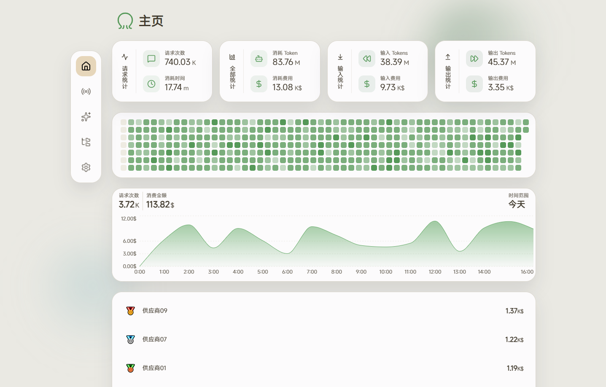</td>
<td>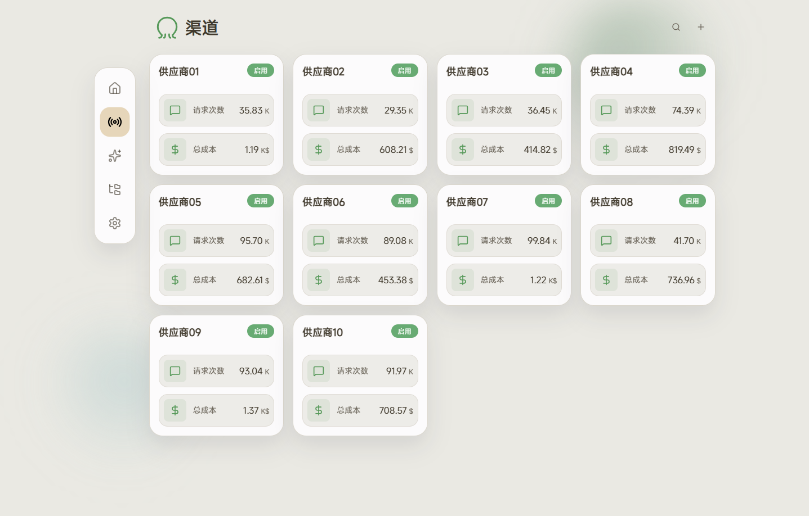</td>
<td>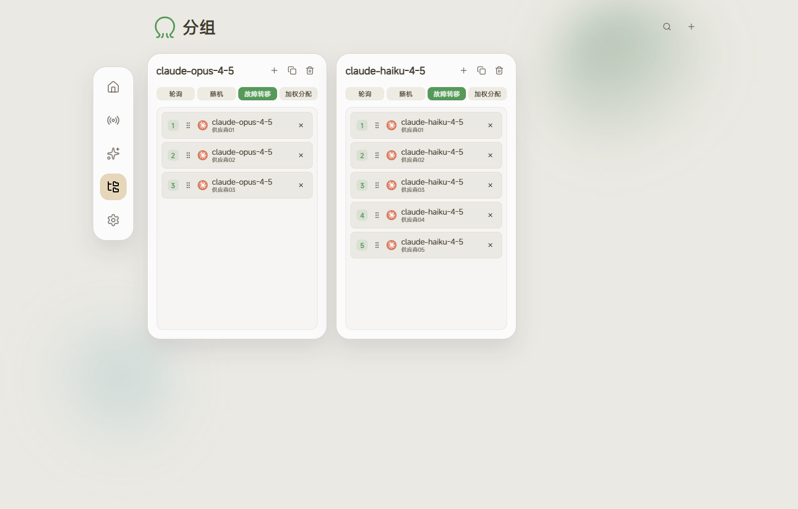</td>
</tr>
<tr>
<td align="center"><b>价格管理</b></td>
<td align="center"><b>日志</b></td>
<td align="center"><b>设置</b></td>
</tr>
<tr>
<td>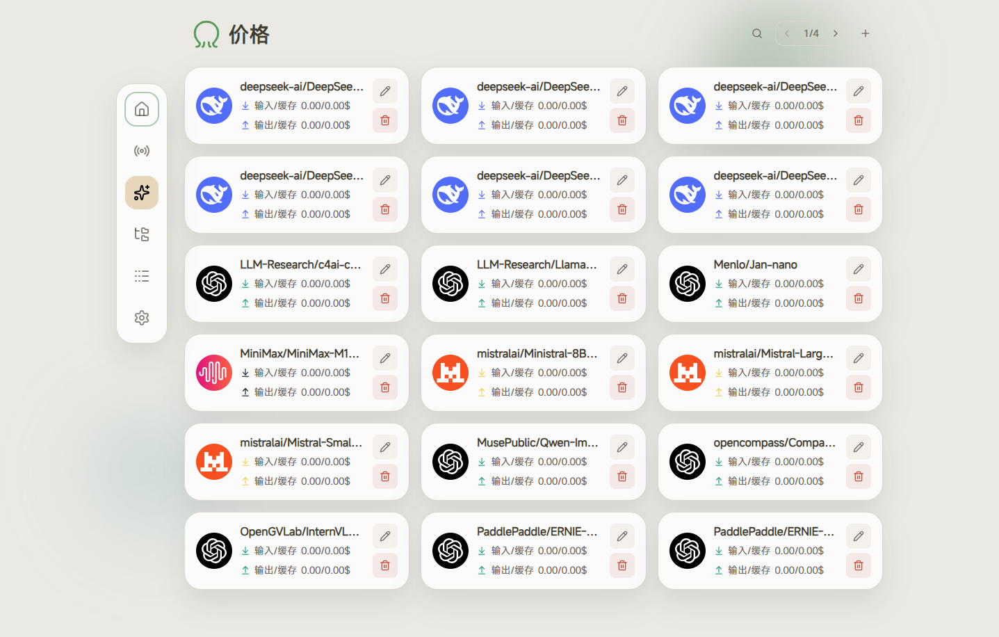</td>
<td>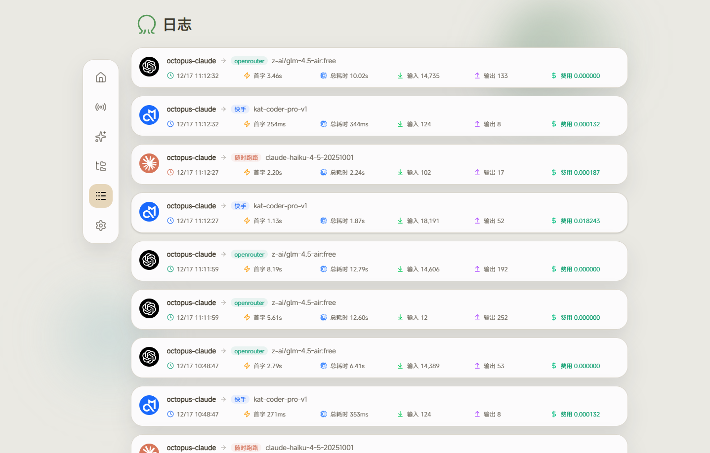</td>
<td>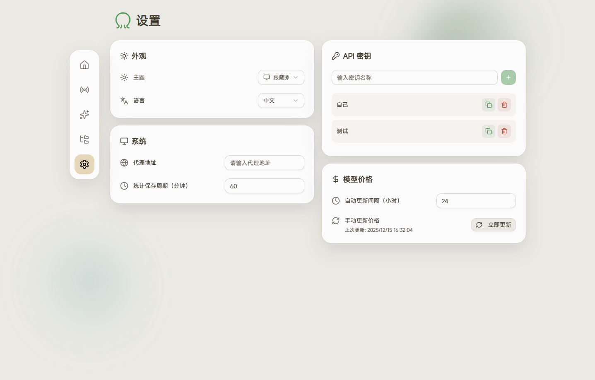</td>
</tr>
</table>
</div>

### 移动端

<div align="center">
<table>
<tr>
<td align="center"><b>首页</b></td>
<td align="center"><b>渠道</b></td>
<td align="center"><b>分组</b></td>
<td align="center"><b>价格</b></td>
<td align="center"><b>日志</b></td>
<td align="center"><b>设置</b></td>
</tr>
<tr>
<td>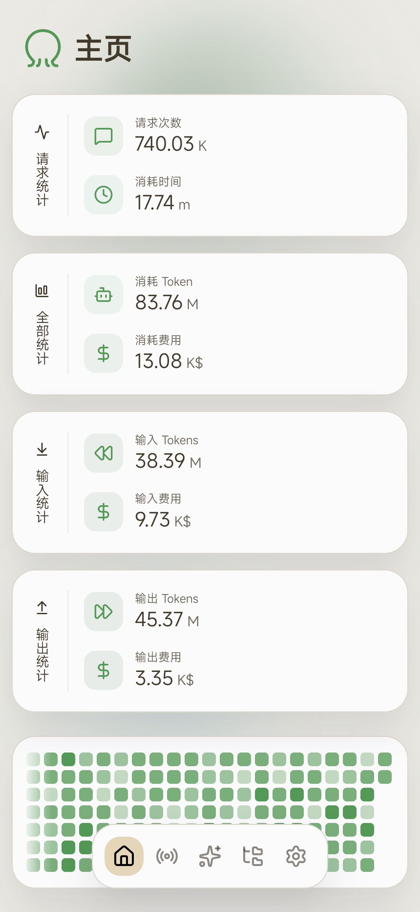</td>
<td>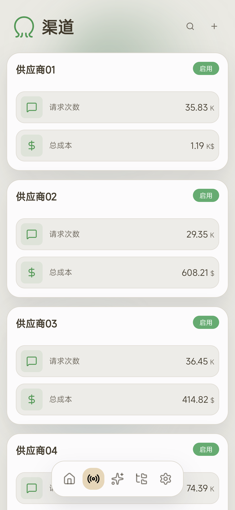</td>
<td>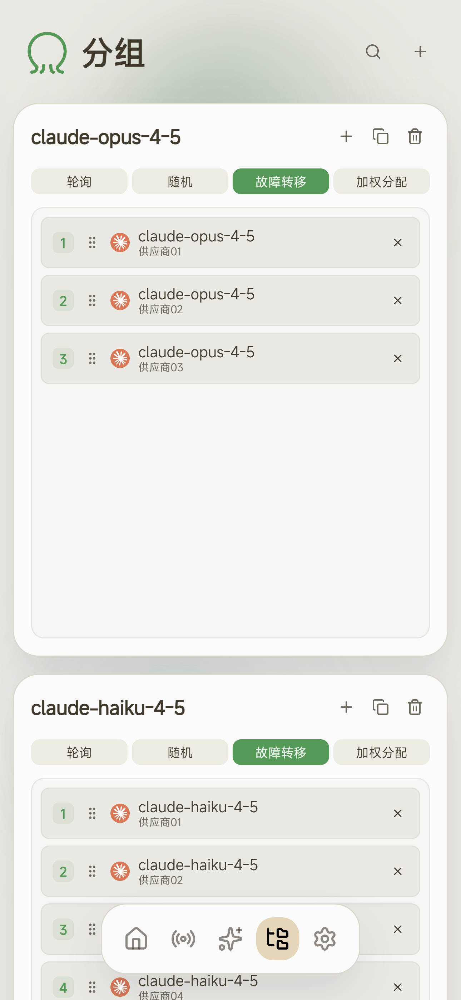</td>
<td>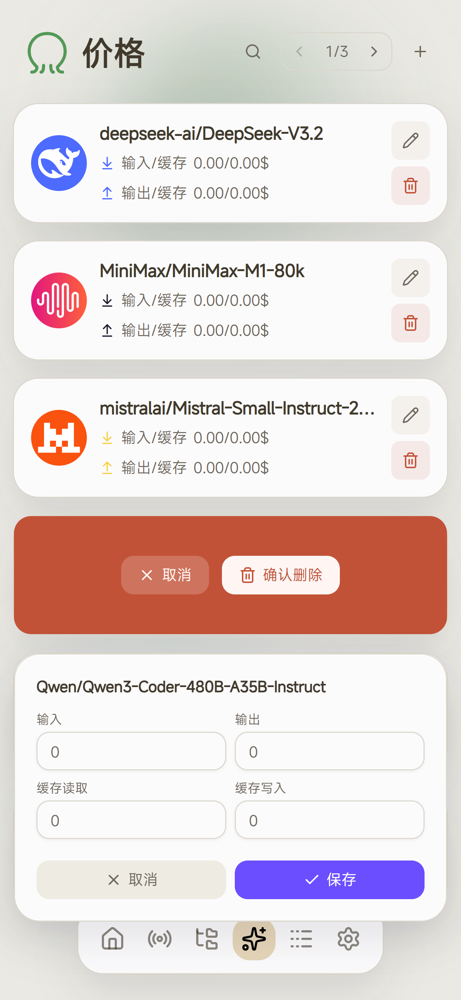</td>
<td>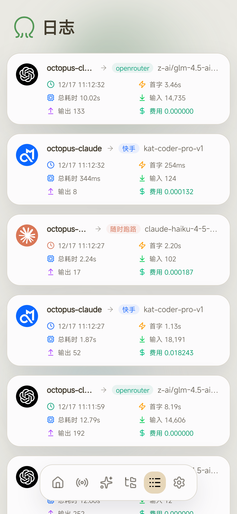</td>
<td>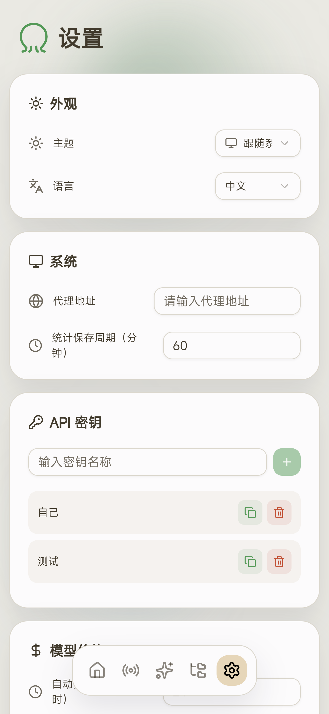</td>
</tr>
</table>
</div>

> 较新页面（用户、审计、限流、运维中心、计费、上架台）的截图尚未采集；它们沿用与上图相同的布局。

---

## 文档

设计笔记在 `docs/` 里，在决策当时写下、而非事后重构：

| 文档 | 覆盖 |
|------|------|
| [billing-detail.md](docs/billing-detail.md) | 计费记录、余额台账、CSV 导出 |
| [billing-audit.md](docs/billing-audit.md) | "余额没扣"那次排查，以及真正的问题 |
| [channel-pricing.md](docs/channel-pricing.md) | 按渠道 / 按凭据改价工作台 |
| [image-generation.md](docs/image-generation.md) | 生图支持：协议、授权、按张计费 |
| [reliability-first-batch.md](docs/reliability-first-batch.md) | 超时、重试、冷却、等待队列 |
| [ops-observability.md](docs/ops-observability.md) | 日志检索/导出、`/healthz`、`/metrics`、运维总览 |
| [ops-alert-loop.md](docs/ops-alert-loop.md) | 告警循环与健康驱动告警 |
| [ops-second-batch.md](docs/ops-second-batch.md) | 第二轮运维可靠性 |
| [probes-and-alert-rules.md](docs/probes-and-alert-rules.md) | 探针认证、可配置告警规则 |
| [backup-hardening.md](docs/backup-hardening.md) | AES-256-GCM 加密、WebDAV 推送、校验和 |
| [audit-export-and-low-balance.md](docs/audit-export-and-low-balance.md) | 审计 CSV 导出与低余额告警 |
| [site-info-distribution.md](docs/site-info-distribution.md) | 站点配置端点、消费方、时序、布局陷阱 |
| [frontend-tests.md](docs/frontend-tests.md) | vitest 覆盖了什么 |
| [roadmap.md](docs/roadmap.md) | 待办，含被否决项及原因 |

---

## 从源码构建

**要求：** Go `1.26.4`（见 `go.mod`）、Node.js `^20.19 || >=22.12`（Vite 8 需要）、pnpm。

```bash
git clone https://github.com/alvindingpeng/tokenmarket.git
cd tokenmarket
cd web && pnpm install && pnpm run build && cd ..   # 前端必须先构建
go run main.go start
```

> 💡 `static/static.go` 把 `static/out` 嵌进二进制。**先**构建前端、再构建后端，
> 否则今天的二进制里装的是昨天的界面。

部署时两个构建脚本要紧：

```bash
bash scripts/build-local.sh -o /path/to/binary   # 本地：web + 后端，注入两处版本号
bash scripts/build.sh                            # 发布矩阵：交叉编译所有平台
```

`build-local.sh` 从同一来源把 `VITE_APP_VERSION` 传给前端、把 `-X internal/conf.Version` 传给后端。
裸 `go build` 得到 `version=dev`，界面会警告前后端版本不一致 —— 这正是这里曾经误诊过一次"资产过期"警报的原因。

**开发模式**（热更新，API 代理到 `127.0.0.1:8080`）：

```bash
cd web && pnpm run dev     # http://localhost:5173
go run main.go start       # 另开一个终端
```

---

## 测试与 CI

```bash
cd web && pnpm exec tsc --noEmit        # 类型检查（也包含在 pnpm run build 里）
cd web && pnpm run test                 # 前端单测 53 条 / 10 个文件
go vet ./internal/...                   # 后端静态检查
go test ./internal/...                  # 后端单元测试
gofmt -l internal/server/handlers/      # 必须不输出任何内容（只对 handlers 门禁，internal/ 仍有历史遗留格式）
```

- vitest 覆盖的是**纯前端逻辑**：价格格式化、统计计算、URL 拼装。这套测试是本项目从零建起来的，
  见 [docs/frontend-tests.md](docs/frontend-tests.md)。
- 后端单元测试在 `internal/model`、`internal/op`、`internal/ratelimit`、`internal/relay` 里（自动添加的
  合并规则、告警去重、备份加密与异地推送、日志脱敏、限制钳制、等待队列）。跨全栈的行为由一套仓库外的
  端到端回归覆盖（156 条断言：计费、结算、限流、生图协议、自动添加规则）。它从当前源码
  构建临时二进制，用独立端口与全新 SQLite 库，因此绝不触碰生产数据。
- `.github/workflows/build.yaml` 每次 push 都构建前端与后端。`.github/workflows/release-assets.yaml`
  在版本标签上构建前端和标准跨平台压缩包，并上传到对应 Release；旧的 `release.yaml` 工作流与本项目的发布产物流程分离。

---

## 版本号与发布

每次更新都带版本号，并把更新说明写进本仓库。

| 真相来源 | 位置 | 谁读它 |
|----------|------|--------|
| 版本号 | `main.go` 里的 `// Version vX.Y.Z` 标记 | `scripts/version.sh`、CI 发布、`scripts/publish-release.sh` |
| 发布说明 | [CHANGELOG.md](CHANGELOG.md) 的 `## vX.Y.Z` 小节 | `scripts/publish-release.sh` → GitHub Release 正文 |

本项目的语义化版本约定：新增用户可见能力 +**次版本号**；仅修复、样式、文案与文档 +**修订号**。
运行时版本出现在 `switchyard version`、`/healthz`、`switchyard_build_info` 与界面的设置 → 信息页。

一个 `post-commit` 钩子实时保持仓库同步：先把 `HEAD` 推到 GitHub 的 `main`，然后 —— 若标记变了
—— 打标签、推标签，并从对应的 CHANGELOG 小节创建 Release（幂等：用 PATCH 而非重复创建）。
日志：`.git/auto-push.log`、`.git/publish-release.log`。

> ⚠️ **在提交前改 `main.go`**，而不是提交后。不改版本号就提交，会让下次发布尝试把已有标签的 Release
> 重指向一个新提交，而标签还停在后面。

完整流程见 [docs/release-versioning.md](docs/release-versioning.md)，自更新与产物流水线见
[docs/update-pipeline.md](docs/update-pipeline.md)，每版变更见 [CHANGELOG.md](CHANGELOG.md)。

---

## 路线图

已知缺口，推理留在代码所在处：

| 领域 | 状态 |
|------|------|
| 生视频（`/v1/videos` 创建/查询/取消） | 已完成：按条固定价 + 按秒时长价计费，任务归属落库以支持轮询定位上游 |
| 生图流式（`partial_images` 事件流）与上游用量对账 | 未开始 |
| 用探测而非名称关键词识别模型能力 | 已完成（v0.19.0）：由能力注册表驱动，名称关键词仅作兜底 |
| 定时同步渠道模型（而非保存时触发） | 暂不采纳：上游费用与变更量不可控 |
| 自动定价 / 自动上架 | 刻意不做：两者都是动钱的动作 |
| 应用内自更新 | 已对管理员启用；检查本项目的 Release，并从对应 `switchyard-<os>-<arch>.zip` 产物原子替换服务二进制 |
| 容器镜像 | 不发布 |

完整待办：[docs/roadmap.md](docs/roadmap.md)。

---

## 致谢

- 🙏 本项目基于早期开源工作构建（见 LICENSE）。
- 🙏 [looplj/axonhub](https://github.com/looplj/axonhub) —— 本项目的 LLM API 适配模块源自该仓库的实现
- 📊 [sst/models.dev](https://github.com/sst/models.dev) —— 模型价格数据
- 💬 [Linux.do](https://linux.do/)

## 许可证

AGPL-3.0-only，见 [LICENSE](LICENSE)。
